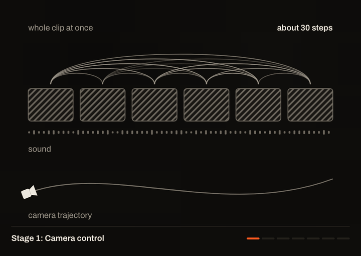

<p align="center">
  <a href="https://SparkDiffusion-AR.github.io/">
    <picture>
      <source media="(prefers-color-scheme: dark)" srcset=".github/assets/sparkstream-logo-dark.svg">
      
    </picture>
  </a>
</p>

<p align="center">
  <b>Streaming long audio-video generation, post-trained from MiniMax H3 33B</b><br>
  Peking University, Melon Group &nbsp;&nbsp;&nbsp; Alibaba Group
</p>

<p align="center">
  <a href="https://SparkDiffusion-AR.github.io/"></a>
  <a href="https://huggingface.co/MiniMaxAI/MiniMax-H3"></a>
</p>

<p align="center">English | <a href="README.zh-CN.md">简体中文</a></p>

<p align="center">
  <a href="https://SparkDiffusion-AR.github.io/#demos">
    
  </a>
  <br>
  <sub>Generated clips, playing in turn (silent excerpt). Each clip starts from a given first frame. Watch them with sound on the <a href="https://SparkDiffusion-AR.github.io/#demos">project page</a>.</sub>
</p>

## Overview

SparkStream is a streaming audio-video generation model post-trained from MiniMax H3 33B. H3 generates a whole audio-video clip of about 6.6 s at once, in about 30 denoising steps; SparkStream generates video and sound chunk by chunk, in only 4 denoising steps per chunk.

Each chunk covers about 0.7 s of video and is conditioned on a text prompt, a given first frame and a camera trajectory. To generate a chunk, the model reads from its KV cache only the prompt, the first frame and up to 5 preceding chunks, so the compute per chunk does not grow with video length. From chunk 3 on, sparse attention reduces the attention compute further. The model is also trained with 8-bit (MXFP8) fake quantization. A single RTX 5090 can generate 10 s of video and sound.

Each demo clip on the project page is 20 s long (about 29 chunks) and was generated chunk by chunk from its first frame.

## From H3 to SparkStream

| Step | How | Reduces |
| --- | --- | --- |
| MiniMax H3 33B (base) | whole clip at once, about 30 steps | |
| Chunk-by-chunk generation | each chunk reads up to 5 preceding chunks from the cache | context read per chunk |
| 4-step distillation | about 30 steps to 4 per chunk | denoising steps |
| RoLA sparse attention | from chunk 3, exact attention on about 10% of video token groups | attention compute |
| MXFP8 quantization-aware training | weights and activations of the backbone attention and FFN layers in 8 bits | bit width, 16 to 8 |

The end-to-end speed-up of distributed inference on RTX 5090s is still being measured.

## Training

SparkStream is trained in seven successive stages. Only the LoRA and RoLA parameters added to H3 are trained; the 33B H3 weights stay frozen. Stage 1 adds camera control to H3, and stages 2 to 4 turn it into a chunk-by-chunk model with sparse attention and 4 denoising steps. From stage 5 on, the model is trained on its own generated history and adapted to quantized inference and longer videos.

<p align="center">
  
</p>

## Status

This repository holds the source of the project page only; it contains no model code or weights. The paper, code and model weights are not public yet.

## Build the page

```bash
npm ci
npm run dev
```

Pushing to `main` builds and deploys the site with GitHub Actions. Maintainer notes (in Chinese) are in [CONTRIBUTING.md](CONTRIBUTING.md).

## Acknowledgements

SparkStream is post-trained from [MiniMax H3](https://huggingface.co/MiniMaxAI/MiniMax-H3) 33B and builds on [SolarWM](https://github.com/Junchao-cs/SolarWM), RoLA, [SparkDiffusion](https://sparkdiffusion.github.io/), Light Forcing, ForgeWM, Causal Forcing, Causal Forcing++, Self Forcing, Self Gradient Forcing, SGF+, DMD2 and PRoPE. Use of H3 and its outputs, including the sample clips on the page, is subject to the [MiniMax H3 Community License](https://huggingface.co/MiniMaxAI/MiniMax-H3/blob/main/LICENSE). The fonts in `fonts/` are under the SIL Open Font License 1.1.
