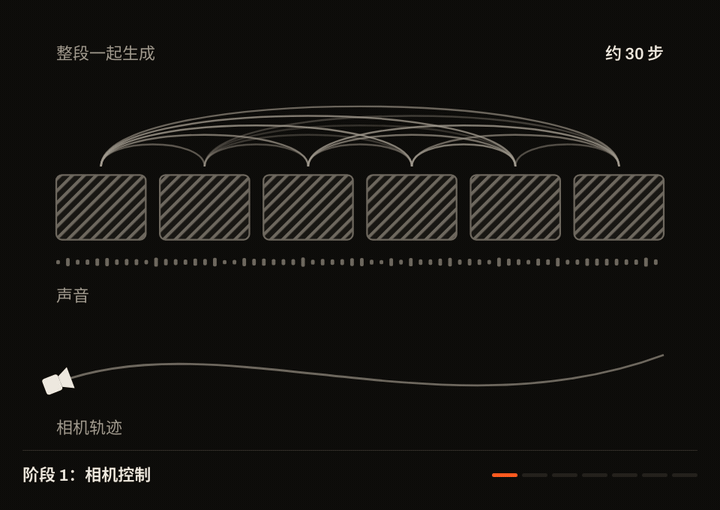

<p align="center">
  <a href="https://sparkdiffusion-ar.github.io/">
    <picture>
      <source media="(prefers-color-scheme: dark)" srcset=".github/assets/sparkstream-logo-dark.svg">
      
    </picture>
  </a>
</p>

<p align="center">
  <b>流式长音视频生成，由 MiniMax H3 33B 后训练而成</b><br>
  北京大学 Melon Group &nbsp;&nbsp;&nbsp; 阿里巴巴集团
</p>

<p align="center">
  <a href="https://sparkdiffusion-ar.github.io/"></a>
  <a href="https://huggingface.co/MiniMaxAI/MiniMax-H3"></a>
</p>

<p align="center"><a href="README.md">English</a> | 简体中文</p>

<p align="center">
  <a href="https://sparkdiffusion-ar.github.io/#demos">
    
  </a>
  <br>
  <sub>生成样片轮播（无声节选），每段都从给定的第一帧开始。带声音的完整样片见<a href="https://sparkdiffusion-ar.github.io/#demos">项目主页</a>。</sub>
</p>

## 简介

SparkStream 是由 MiniMax H3 33B（330 亿参数）后训练而成的流式音视频生成模型。H3 一次生成整段约 6.6 秒的音视频，要去噪约 30 步；SparkStream 改为逐块生成，每块只去噪 4 步。

每块是约 0.7 秒的视频，根据提示词、第一帧和相机轨迹生成。生成每一块时，从缓存只读取提示词、第一帧和前面最多 5 块，因此每块的计算量不随视频变长而增加。从第 3 块起改用稀疏注意力，进一步减少计算量；训练时还对模型做了 8 位精度（MXFP8）的伪量化，单张 RTX 5090 上就能生成 10 秒的音视频。

项目主页上的每段样片都是从第一帧开始逐块生成的 20 秒，约 29 块。

## 从 H3 到 SparkStream

| 环节 | 做法 | 减少的开销 |
| --- | --- | --- |
| MiniMax H3 33B（底座） | 整段一起生成，约 30 步 | |
| 逐块生成 | 每块只从缓存读取前面最多 5 块 | 每块读取的上下文 |
| 4 步蒸馏 | 约 30 步减到每块 4 步 | 去噪步数 |
| RoLA 稀疏注意力 | 第 3 块起，每个查询组只精确计算约 10% 的视频 token 组 | 注意力计算量 |
| MXFP8 量化感知训练 | 主干注意力和前馈层的权重和激活用 8 位 | 位宽从 16 位降到 8 位 |

多张 RTX 5090 分布式推理的端到端加速还在测量。

## 训练

SparkStream 的训练分七个阶段，依次进行。全程只训练附加在 H3 上的 LoRA 和 RoLA 参数，H3 本身的 330 亿参数保持冻结。阶段 1 给 H3 加上相机控制，阶段 2 到 4 把它改成逐块生成、稀疏注意力、每块 4 步；从阶段 5 起，模型在自己生成的历史上训练，并适应量化推理和更长的视频。

<p align="center">
  
</p>

## 现状

本仓库只有项目主页的源码，不含模型代码和权重。论文、代码和模型权重目前都没有公开。

## 本地预览

```bash
npm ci
npm run dev
```

推送到 `main` 后，GitHub Actions 自动构建并发布。维护说明见 [CONTRIBUTING.md](CONTRIBUTING.md)。

## 致谢

SparkStream 在 [MiniMax H3](https://huggingface.co/MiniMaxAI/MiniMax-H3) 33B 上后训练而成，用到了 [SolarWM](https://github.com/Junchao-cs/SolarWM)、RoLA、[SparkDiffusion](https://sparkdiffusion.github.io/)、Light Forcing、ForgeWM、Causal Forcing 与 Causal Forcing++、Self Forcing、Self Gradient Forcing 与 SGF+、DMD2 和 PRoPE 的工作。H3 及其输出（包括页面上的样片）的使用遵守 [MiniMax H3 Community License](https://huggingface.co/MiniMaxAI/MiniMax-H3/blob/main/LICENSE)。`fonts/` 里的字体按 SIL Open Font License 1.1 授权。
